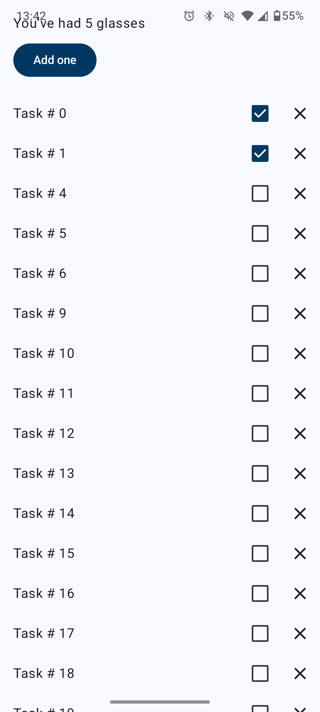
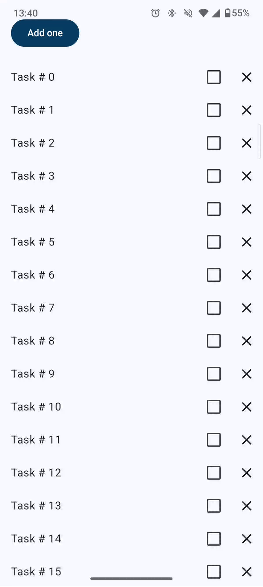

# Estado no Jetpack Compose (Wellness App)

Este repositório contém a implementação prática desenvolvida durante o codelab **[State in Jetpack Compose (Estado no Jetpack Compose)](https://developer.android.com/codelabs/jetpack-compose-state?hl=pt-br#0)**, disponibilizado pelo Google.

O objetivo deste projeto é dominar a gestão de estado em interfaces declarativas no Android, explorando o ciclo de recomposição, elevação de estado (*State Hoisting*), mutabilidade de listas reativas e integração com arquitetura baseada em **ViewModel**.

## Tecnologias e Ferramentas Utilizadas

- **Linguagem:** Kotlin
- **UI Framework:** Jetpack Compose (Material Design 3)
- **Gestão de Estado:** `mutableStateOf`, `remember`, `rememberSaveable`, `toMutableStateList()`
- **Arquitetura:** MVVM (Model-View-ViewModel) com `ViewModel` da Jetpack
- **IDE:** Android Studio
- **Mínimo SDK:** API level 24+

## Conceitos e Aprendizados Práticos

Durante o desenvolvimento deste codelab, os seguintes conceitos foram consolidados:

### 1. Fundamentos de Estado e Recomposição
- **Estado na UI:** Entendimento do estado como qualquer valor que altera a interface ao longo do tempo.
- **`remember` e `rememberSaveable`:** Uso de `remember` para preservar estado local durante recomposições e `rememberSaveable` para reter valores após alterações de configuração (como a rotação do ecrã).

### 2. Elevação de Estado (State Hoisting)
- Separação entre componentes com estado (*Stateful*) e sem estado (*Stateless*) para promover reutilização, desacoplamento e testabilidade dos composables.

### 3. Listas Reativas e Mutabilidade
- Uso do `toMutableStateList()` para observar alterações em coleções (adição, remoção e edição de tarefas) permitindo que o `LazyColumn` responda dinamicamente às modificações.

### 4. Integração com ViewModel
- Deslocamento do estado de negócio da UI para a classe `WellnessViewModel`.
- Garantia de sobrevivência do estado aos ciclos de vida das Activitys.

## Evidências do Projeto (Demonstração Prática)

### 1. Interface da Aplicação
Demonstração do contador de copos de água e da lista dinâmica de tarefas de bem-estar.

| Contador e Lista de Tarefas |
| :---: |
|  |

### 2. Fluxo Interativo, Estado e Rotação (GIF)
Demonstração do incremento de copos de água, marcação/remoção de tarefas na lista e preservação do estado após a rotação do ecrã.

| Funcionamento do Estado e Recomposição |
| :---: |
|  |

## Como Executar o Projeto

1. Clone o repositório:
   ```bash
   git clone https://github.com/leticia-farias/basic-state-compose.git
2. Abra o projeto no Android Studio.
3. Aguarde o término da sincronização do Gradle.
4. Execute o aplicativo num emulador ou dispositivo físico (API 24+).
